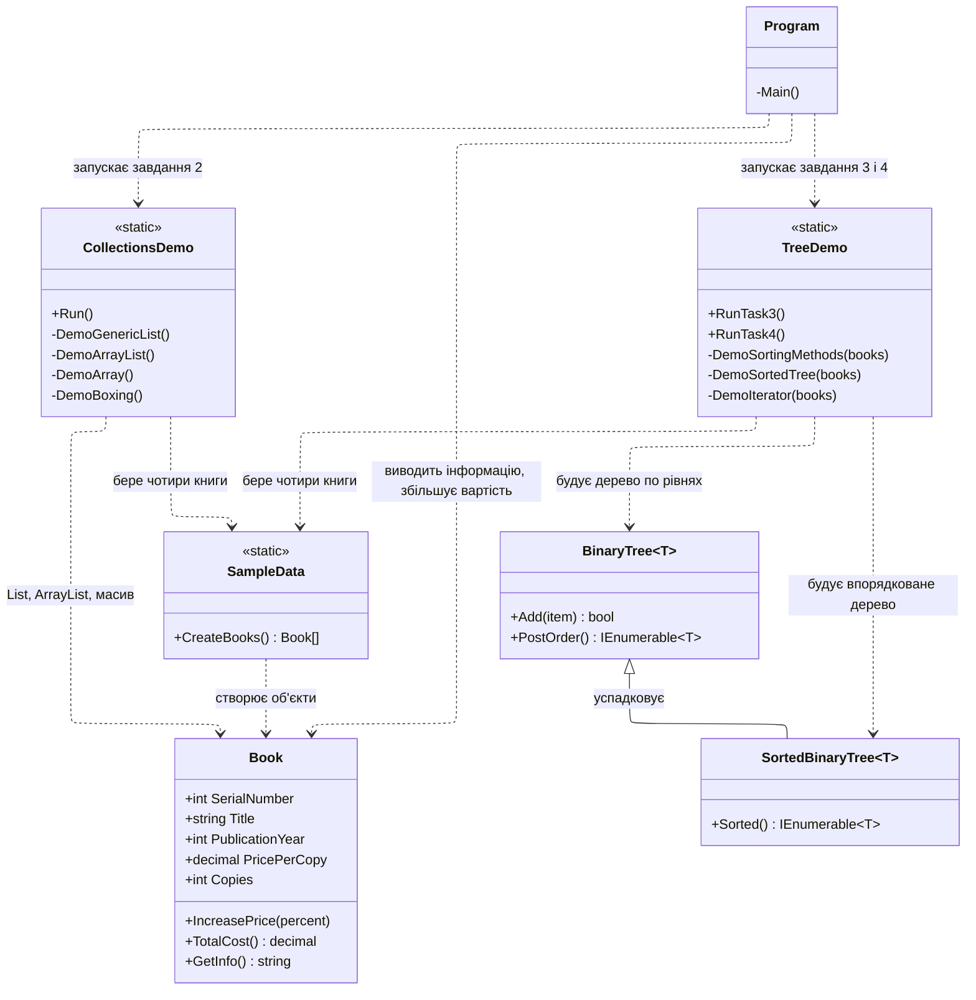
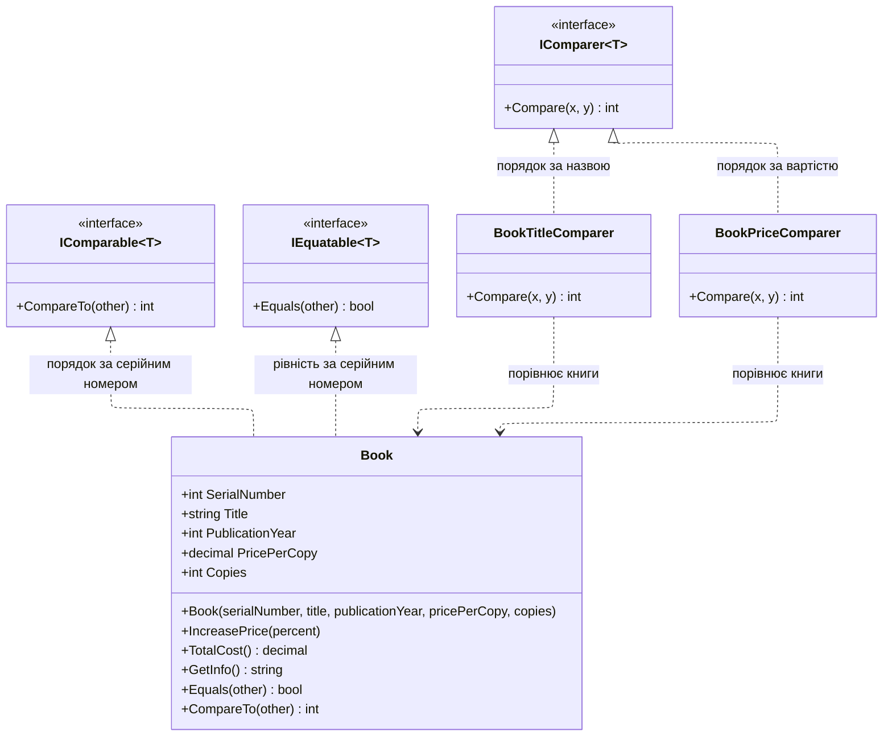
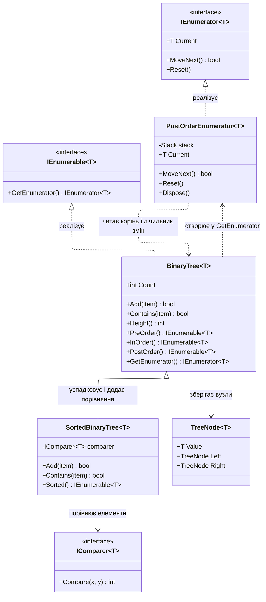
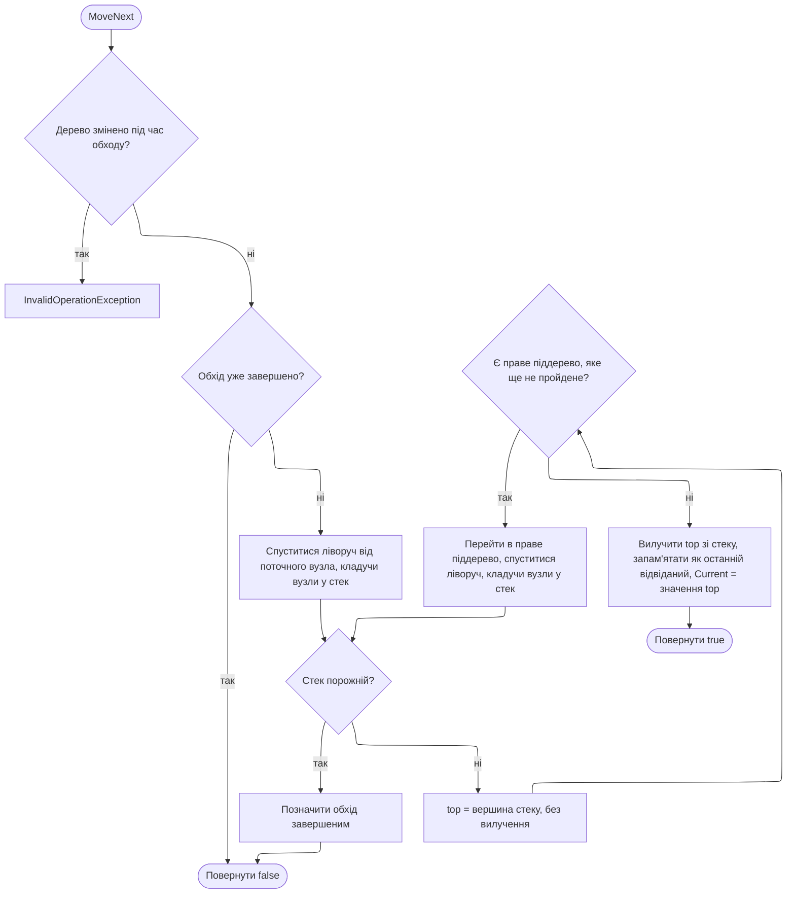
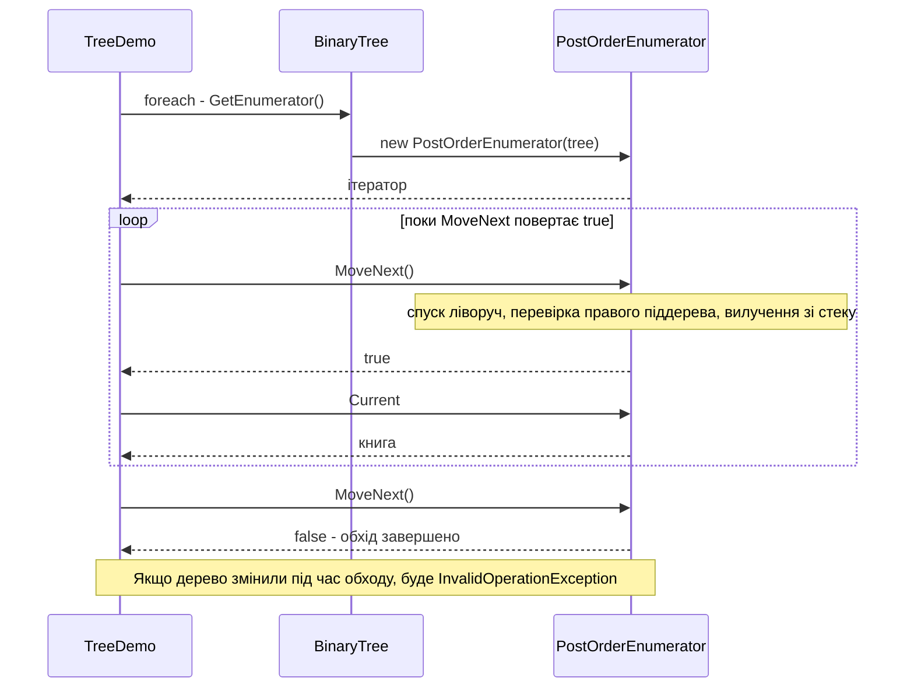

# Схеми до лабораторної роботи 2 - варіант 2

## 1. Діаграми класів

### 1.1. Загальна діаграма: хто що демонструє



### 1.2. Клас Book і порівняння



### 1.3. Узагальнене дерево та власний ітератор



Обмеження `where T : class` стоїть на `BinaryTree<T>`, `SortedBinaryTree<T>` і `PostOrderEnumerator<T>`: структури не можуть бути елементами дерева.

## 2. Структура дерев на прикладі чотирьох книг

Книги додаються в порядку серійних номерів 305, 102, 407, 210.

`BinaryTree`: елементи додаються по рівнях, зліва направо.

```
№305 Кобзар                                  (корінь)
├── ліве:  №102 Лісова пісня
│   ├── ліве:  №210 Захар Беркут
│   └── праве: (порожньо)
└── праве: №407 Тіні забутих предків
```

`SortedBinaryTree` (за серійним номером): менші елементи ліворуч, більші праворуч.

```
№305 Кобзар                                  (корінь)
├── ліве  (менше):  №102 Лісова пісня
│   ├── ліве:  (порожньо)
│   └── праве (більше): №210 Захар Беркут
└── праве (більше): №407 Тіні забутих предків
```

Зворотний обхід (ліве, праве, корінь) обох дерев: №210, №102, №407, №305.
Центрований обхід: для `BinaryTree` - №210, №102, №305, №407, для `SortedBinaryTree` - №102, №210, №305, №407 (відсортовано).

## 3. Алгоритм методу MoveNext власного ітератора



## 4. Взаємодія об'єктів: foreach по дереву


